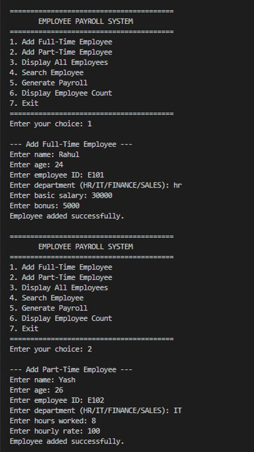
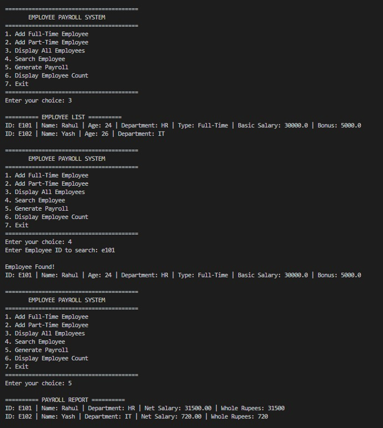
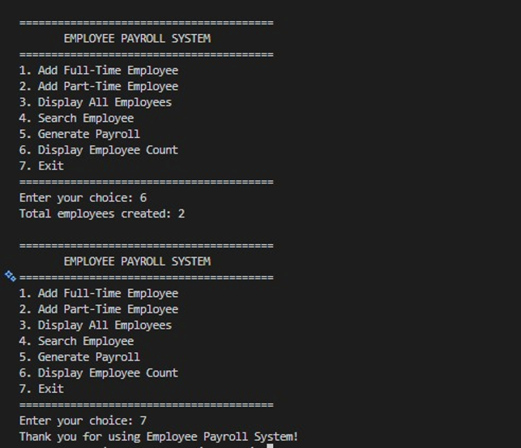

# Employee Payroll Management System

## About the Project

The **Employee Payroll Management System** is a console-based Java application developed as part of our Java Programming coursework. The project demonstrates how Object-Oriented Programming (OOP) concepts can be applied to a practical problem involving employee management and salary calculation.

The application supports two types of employees: **Full-Time Employees** and **Part-Time Employees**. Through a menu-driven interface, users can add employee details, view all registered employees, search for an employee using their ID, generate payroll reports, and check the total number of employees created.

The main objective of this project is to combine Java programming concepts into one functional application while maintaining a clear and organized code structure.

## Architecture

[](https://gitdiagram.com/vikasachar27-jpg/employee_payroll_system) 
*(Click the badge to explore the interactive architecture diagram of the project - update link before publishing)*

The application is organized into three custom packages: `main`, `model`, and `service`. Each package has a specific responsibility, making the project easier to understand and maintain.

* **Main package:** Contains `PayrollApp.java`, which provides the console menu, accepts user input, and connects user actions to the payroll service.
* **Model package:** Contains `Person`, `Employee`, `FullTimeEmployee`, `PartTimeEmployee`, the `Department` enum, and the `Payable` interface. These classes define employee information and salary-related behavior.
* **Service package:** Contains `PayrollService.java`, which manages the employee array and provides methods for adding, displaying, searching, and processing employee payrolls.

The abstract `Employee` class extends `Person` and implements the `Payable` interface. `FullTimeEmployee` and `PartTimeEmployee` extend `Employee` and implement their own salary calculation logic.

## Features

* Add Full-Time and Part-Time Employees
* Store multiple employee objects in an array
* Display employee details
* Search employees by Employee ID
* Generate payroll reports
* Display the total employee count
* Select departments using an enum
* Calculate net salary after tax deduction
* Use formatted console output for payroll details
* Navigate the application through a menu-driven interface

## How Payroll Works

### Full-Time Employee

The salary of a full-time employee is calculated using the basic salary and bonus. A 10% tax deduction is applied to the gross salary.

**Formulas:**

- Gross Salary = Basic Salary + Bonus
- Tax = Gross Salary × 10%
- Net Salary = Gross Salary − Tax

**Example:**

| Component | Amount |
|---|---:|
| Basic Salary | ₹30,000 |
| Bonus | ₹5,000 |
| Gross Salary | ₹35,000 |
| Tax (10%) | ₹3,500 |
| **Net Salary** | **₹31,500** |

### Part-Time Employee

The salary of a part-time employee depends on the number of hours worked and the hourly rate. The same 10% tax deduction is applied to the gross salary.

**Formulas:**

- Gross Salary = Hours Worked × Hourly Rate
- Tax = Gross Salary × 10%
- Net Salary = Gross Salary − Tax

**Example:**

| Component | Amount |
|---|---:|
| Hours Worked | 8 |
| Hourly Rate | ₹100 |
| Gross Salary | ₹800 |
| Tax (10%) | ₹80 |
| **Net Salary** | **₹720** |

## Object-Oriented Programming Concepts

This project demonstrates the following Java concepts:

- **Encapsulation:** Private fields with public getters and setters protect employee data.
- **Inheritance:** `Employee` extends `Person`, while `FullTimeEmployee` and `PartTimeEmployee` extend `Employee`.
- **Abstraction:** The abstract `Employee` class defines common employee behaviour and an abstract `calculateSalary()` method.
- **Polymorphism:** Overridden salary calculation methods are selected at runtime according to the actual employee object.
- **Interfaces:** The `Payable` interface defines the common salary calculation contract.
- **Method Overloading:** `searchEmployee()` supports different parameter lists.
- **Constructor Overloading:** `Person` provides default and parameterized constructors.
- **Method Overriding:** Both subclasses implement their own `calculateSalary()` method.
- **`this` and `super`:** Used to refer to the current object and access parent-class constructors or methods.
- **Static and Final Members:** Used for the employee counter, tax-rate constant, and final display method.
- **Enum:** `Department` restricts department selection to predefined values.
- **Arrays of Objects:** An `Employee` array stores full-time and part-time employee objects.
- **Type Casting and String Methods:** Demonstrated during salary processing and employee ID searching.
- **Control Flow and Packages:** Loops, conditional statements, jump statements, and custom packages organize the application's logic.

## Project Structure

```text
Employee_Payroll_System/
├── src/
│   ├── main/
│   │   └── PayrollApp.java
│   ├── model/
│   │   ├── Person.java
│   │   ├── Employee.java
│   │   ├── FullTimeEmployee.java
│   │   ├── PartTimeEmployee.java
│   │   ├── Department.java
│   │   └── Payable.java
│   └── service/
│       └── PayrollService.java
├── add_employees.png
├── employee_search.png
├── payroll_report.png
├── README.md
└── requirements.txt
```

## Requirements

- Java JDK 17 or higher
- Visual Studio Code or any Java-compatible IDE

## How to Run

Open a terminal in the project root directory.

### 1. Compile the Java source files

```powershell
javac -d out src\model\*.java src\service\*.java src\main\*.java
```

### 2. Run the application

```powershell
java -cp out main.PayrollApp
```

After launching the program, follow the menu options and enter the requested employee details.

Requirements
Java JDK 17 or higher
Visual Studio Code or any Java-compatible IDE

How to Run
Open a terminal in the project root directory.

1. Compile the Java source files
javac -d out src/model/*.java src/service/*.java src/main/*.java 

2. Run the application
java -cp out main.PayrollApp 

After launching the program, follow the menu options and enter the requested employee details.

## Sample Console Output

The following screenshots demonstrate the working of the Employee Payroll Management System.

### 1. Adding Employees



### 2. Displaying and Searching Employees



### 3. Generating Payroll




Conclusion
The Employee Payroll Management System demonstrates how Java OOP concepts can be combined to develop a simple and organized application. By separating employee models, payroll operations, and console interaction, the project provides a practical example of inheritance, abstraction, polymorphism, interfaces, and other Java features working together.

